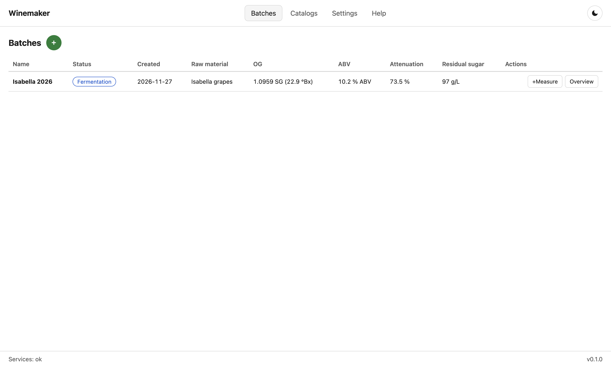

# Winemaker

**English** · [Русский](README_ru.md)

A desktop assistant for winemakers: a batch journal with instrument correction and fermentation analytics. Fully local — no accounts, no network, no telemetry.

## What it is

Winemaker keeps the journal of your fermentation batches: starting gravity, measurements by refractometer and hydrometer, yeast and additions, technological operations (racking, transfer, sugar additions and so on), and the final result of each batch.

The app is made for home winemakers who measure with a refractometer and АС-3-style hydrometers (°Bx scale). It turns raw readings into trustworthy numbers: every measurement is corrected for the instrument's calibration and temperature, and refractometer readings taken during fermentation are adjusted for the alcohol distortion.

## Features

- **Batch journal.** Batches with status lifecycle (fermenting → finishing fermentation → aging → bottling → archived), yeast and additions from your own catalogs, a unified timeline of measurements, operations and status changes.
- **Honest measurements.** Full correction pipeline with a readable trace kept next to every measurement: raw reading → instrument → corrections → canonical value in SG, always shown in both units (SG and °Bx).
- **Refractometer during fermentation.** A two-component physical model (Novotný) corrects readings across the whole fermentation; the classic Terrill formula and a linear Balling model are available as manual overrides.
- **Analytics.** Current and final ABV, apparent attenuation, residual sugar, and a completion forecast shown as an honest date range.
- **Density chart** with per-instrument markers and a clickable link from every point back to the measurement card.
- **Your instruments, your calibration.** Personal WCF from a one-shot calibration pair, per-hydrometer °Bx offset and calibration temperature.
- **Two interface languages** — Russian and English — switched instantly in Settings; English units follow the language (for example, % ABV instead of % vol.).
- **Keyboard-first**: hotkeys for tabs and theme, fast measurement entry in three actions.

## Your data

The app is **local-first**: the database lives in a file on your computer, nothing ever leaves it, and every screen works offline. Your data belongs to you:

- export any batch as a human-readable JSON file readable without the app;
- automatic backups of the database are kept and rotated in the background.

## Install

Download the build for your platform from [GitHub Releases](https://github.com/shamanis/winemaker/releases):

| Platform | Artifact |
|---|---|
| macOS (Apple Silicon) | `Winemaker-<version>-arm64-mac.zip` |
| macOS (Intel) | `Winemaker-<version>-x64-mac.zip` |
| Windows | `Winemaker-<version>-setup.exe` |
| Linux (Debian-based) | `winemaker_<version>_amd64.deb` |
| Linux (other) | `winemaker-<version>-x64.tar.gz` |

## Tech

Electron, React, TypeScript, SQLite. The project is open source under the [MIT license](LICENSE).

See [CHANGELOG.md](CHANGELOG.md) for release notes.
