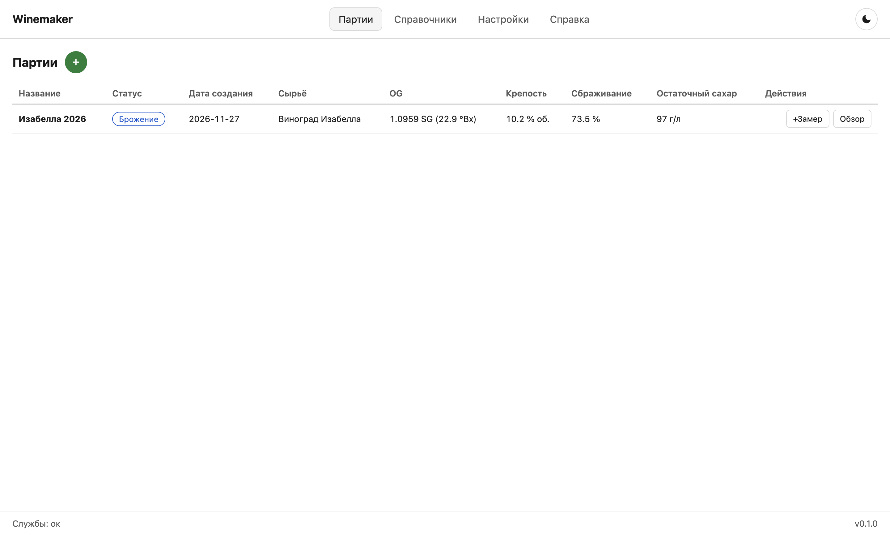

# Winemaker

**Русский** · [English](README.md)

Десктопный помощник винодела: журнал партий с приборной коррекцией замеров и аналитикой брожения. Полностью локальный — без аккаунтов, сети и телеметрии.

## Что это

Winemaker ведёт журнал брожения: стартовая плотность, замеры рефрактометром и ареометром, дрожжи и добавки, технологические операции (снятие с осадка, переливка, внесение сахара и т.п.) и итог каждой партии.

Приложение задумано для домашних виноделов, которые работают с рефрактометром и ареометрами АС-3 (шкала °Bx). Оно превращает сырые показания в достоверные числа: каждый замер корректируется на калибровку и температуру прибора, а показания рефрактометра на брожении — ещё и на спиртовое искажение.

## Возможности

- **Журнал партий.** Партии с жизненным циклом статусов (брожение → дображивание → выдержка → розлив → архив), дрожжи и добавки из собственных справочников, единый таймлайн замеров, операций и переходов статусов.
- **Честные замеры.** Полный конвейер коррекции с читаемым следом рядом с каждым замером: сырая величина → прибор → поправки → каноническое значение в SG; плотность всегда показывается в обеих единицах (SG и °Bx).
- **Рефрактометр на брожении.** Двухкомпонентная физическая модель (Новотный) корректирует показания на всём протяжении брожения; классическая формула Террилла и линейная модель Баллинга — как ручной выбор.
- **Аналитика.** Текущая и финальная крепость, степень сбраживания, остаточный сахар и прогноз завершения — честным диапазоном дат.
- **График плотности** с маркерами по приборам и переходом от любой точки к карточке замера.
- **Ваши приборы, ваша калибровка.** Персональный WCF по одноразовой калибровочной паре, смещение ареометра в °Bx и калибровочная температура.
- **Два языка интерфейса** — русский и английский — с мгновенным переключением в настройках; обозначения единиц следуют языку (например, % ABV вместо % об.).
- **Управление с клавиатуры**: горячие клавиши вкладок и темы, быстрый ввод замера в три действия.

## Ваши данные

Приложение **local-first**: база живёт файлом на вашем компьютере, ничего не покидает его, и все экраны работают без сети. Данные принадлежат вам:

- экспорт любой партии в читаемый JSON-файл, который открывается без приложения;
- автоматические резервные копии базы, которые создаются и ротируются в фоне.

## Установка

Скачайте сборку для своей платформы из [GitHub Releases](https://github.com/shamanis/winemaker/releases):

| Платформа | Артефакт |
|---|---|
| macOS (Apple Silicon) | `Winemaker-<version>-arm64-mac.zip` |
| macOS (Intel) | `Winemaker-<version>-x64-mac.zip` |
| Windows | `Winemaker-<version>-setup.exe` |
| Linux (Debian-подобные) | `winemaker_<version>_amd64.deb` |
| Linux (остальные) | `winemaker-<version>-x64.tar.gz` |

## Технологии

Electron, React, TypeScript, SQLite. Проект открыт под [лицензией MIT](LICENSE).

История релизов — в [CHANGELOG.md](CHANGELOG.md).
